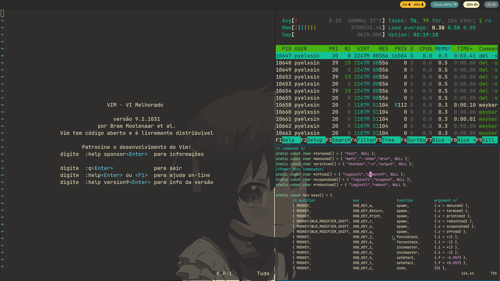
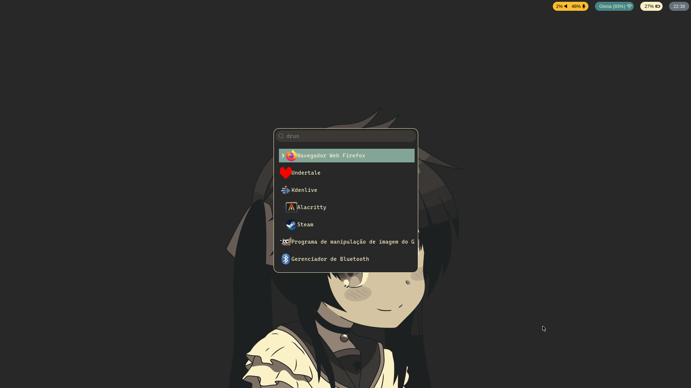

# Dotfiles Wayland:

Contém arquivos de configuração dos seguintes softwares:
> (Consequentemente, Dependências)

- Dwl (Window Manager)
- waybar (Barra de Status)
- wofi(App Launcher)
- foot (Terminal emulator)
- oh-my-posh (Terminal prompt)
- pfech (Infos do Sistema)
- swaybg (Background for wayland)

# Screenshots

